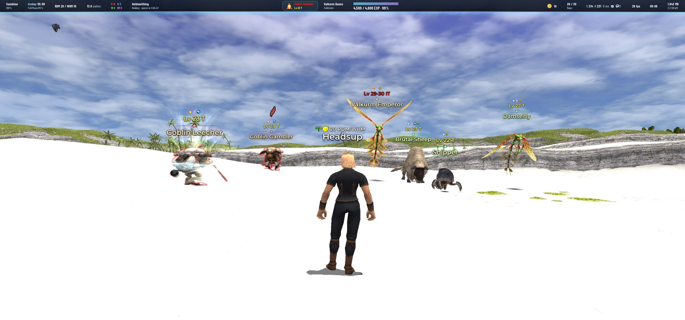
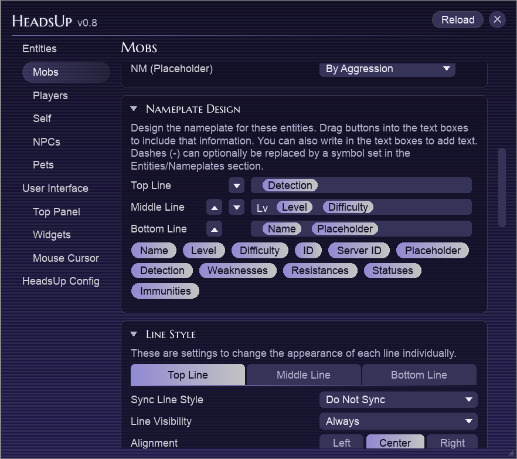
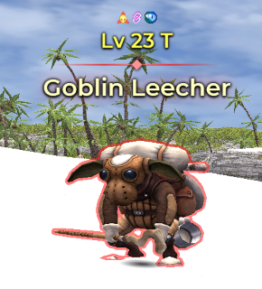
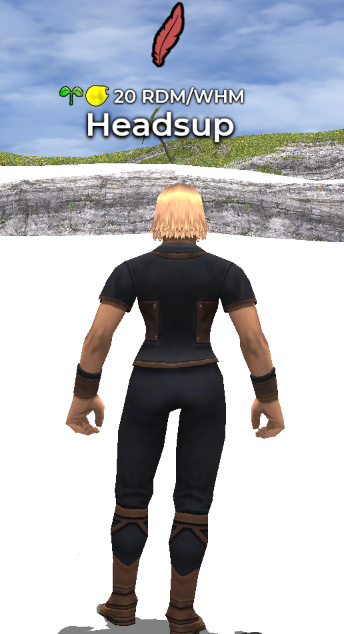
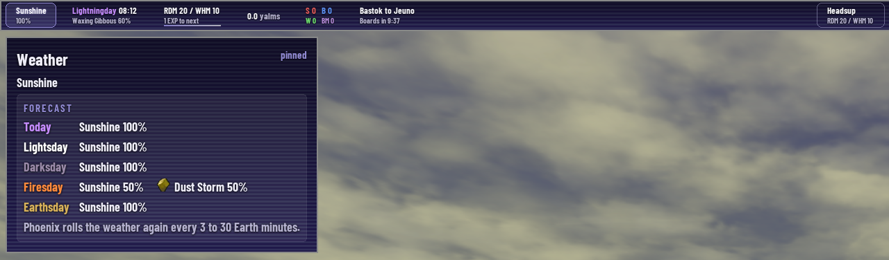

# HeadsUp

An Ashita v4 plugin for Final Fantasy XI on PhoenixXI. It outlines nearby monsters in a color that tells you whether
they will attack you, and replaces the game's nameplates with clearer ones: names, level and con, how a monster
detects you, player status icons and a target cursor. It only reads what the game already shows and the server
already sends, apart from three requests the game's own menus make, which the top panel sends for you: the one the game
sends when you open Region Info, while the panel's Zone widget is on, and the two it sends when you open the
Currencies menu, while the Gil widget is on ([Top panel](#top-panel) says when). It never targets anything itself, and
it checks a monster itself only with Auto-Check switched on, which is off unless you turn it on: it then sends the same
request `/check` does, for monsters alone and never for a player.



Download `HeadsUp.dll` from the latest release on the [Releases](https://github.com/Tanyrus/headsup/releases) page and
put it in Ashita's `plugins` folder, in place of any `headsup.dll` from before. Load it with `/load HeadsUp`; `/hu` opens its settings, and `/hu menu <page>`
opens them at a page, such as `/hu menu entities`, `/hu menu mobs` or `/hu menu toppanel`.

> **About the data:** HeadsUp's monster data (levels, aggression, links and detection) is built from Phoenix's own
> server code: the map server is compiled from Phoenix's public source and records every monster it loads. The top
> bar's zone names, regions, weather forecasts and player titles come from the same source. All of it matches the
> Phoenix version it was built from, so a monster changed on the live server since then can show the wrong color,
> level or icons, a changed zone the wrong name, region or forecast, and a changed title the wrong title.



## Settings

`/hu` opens the settings window. `/hu menu <page>` opens it at a page: `entities`, `mobs`, `players`, `self`, `npcs`,
`pets`, `userinterface`, `toppanel`, `widgets`, `mousecursor` or `configmenu`. The pages, in the order of the window's list:

| Page | Holds |
|---|---|
| Entities | What every kind shares: the Nameplates card, the nameplates' opacity, the outline style, the target cursor and the five color palettes. Under it, a page for each kind: Mobs, Players, Self, NPCs and Pets |
| User Interface | Screenshot mode and the Window Groups and Game Windows cards, which move the game's windows. Under it, the Top Panel, Widgets and Mouse Cursor pages |
| HeadsUp Config | Switches HeadsUp off as a whole, writes a report for bug reports, sets the settings window's own theme, font, size and opacity, and holds the button that puts every setting back to its default |

A switch is a toggle. Settings that belong to something switched off are not shown until it is on, and every option of
a dropdown says what it does when the pointer is over it.

## Outlines and nameplates

Each kind of entity has its own page: Mobs, Players, Self, NPCs and Pets. A page starts with a Visibility card. Each
row of it is a group of entities:

| Page | Rows |
|---|---|
| Mobs | Aggressive, Passive, NM (Aggressive), NM (Passive), NM (Placeholder), Claimed (Yours), Claimed (Others'), Dead, No Data |
| Players | Players, Party Members, Friends, Linkshell Members |
| Pets | Your Pets, Party Pets, Friend Pets, Others' Pets |
| Self, NPCs | One row each |

A row has two choices: what its nameplate does and what its outline does. Giving the claim rows a look of their own
helps in crowded places such as Dynamis.

| Nameplate | What it does |
|---|---|
| Hide Nameplate | No name at all |
| Show Nameplate | HeadsUp's nameplate |
| When Targeted | HeadsUp's nameplate only while the entity is your target |
| Vanilla Nameplate | The game's own name, and nothing of HeadsUp's |

| Outline | What it does |
|---|---|
| No Outline | No outline |
| Show Outline | An outline |
| When Targeted | An outline only while the entity is your target |
| Inherit | On the two Claimed rows and the NM (Placeholder) row only: the mob keeps the outline it would have had otherwise, unclaimed, or by whether it would attack you |

A dead mob is in the Dead row whatever it was, and keeps its name alone. The text of anything dead, a mob or a player,
is dark grey whatever its colors are set to.

Outlines reach up to 50 yalms, as far as the game draws mobs. The Outline Style card on the Entities page sets their
thickness (100% is four pixels), their opacity, their smoothness (Low to Ultra: rounder costs a little more) and their
range, from 15 yalms up. With Fade In on, an outline grows fainter with distance: whole within 10 yalms and almost gone
at the range. Outlines are hidden behind walls, just like the mob.

### Colors

The Outline Design card gives each row's outline a color: one you pick, or one from a palette by the entity's state. The
palettes are cards on the Entities page, and a color that is no longer its default has a small round arrow beside it
that puts the default back:

| Palette | In a dropdown | Colors by |
|---|---|---|
| Colors: Aggression | Color by Aggression | Whether a mob would attack you, with notorious monsters, their placeholders and mobs with no data apart |
| Colors: Toughness | Color by Toughness | How a mob cons to you, from Too Weak to Very Tough, and a color for an unknown level |
| Colors: Claim Status | Color by Claim Status | Unclaimed, claimed by someone else or claimed by you |
| Colors: Targeting | Color by Targeting | Not targeted, targeted, locked on, the sub-target you are picking, and a sub-target out of range |
| Colors: Entity Type | Color by Entity Type | A mob, a player, a friend, a party member, a linkshell member, an NPC or object, or a pet |

A text color can also be Vanilla Color, the game's own color for the name (which shows claim status), or Custom, one
you pick.

The Aggression palette starts with these colors:

| Color | The mob |
|---|---|
| Red | Will attack you |
| Green | Will not: it is passive, or aggressive but Too Weak for you |
| Orange | Is a notorious monster that will attack you |
| Gold | Is a notorious monster that will not |
| Purple | Is a lottery placeholder, whose death can pop a notorious monster |
| Gray | Is not in HeadsUp's data |

A mob's outline, the glow of its name and the ornament of its nameplate all start on this palette. The Passive and No
Data rows start without an outline, so green and gray show at first only in a name's glow and ornament; set either
row's outline to Show Outline to outline those mobs too.

### The nameplate

The Nameplate Design card holds three lines: Top Line, Middle Line and Bottom Line, which sits where the game's own
name does. You type in a line as you would anywhere, and put tags in it: a tag draws something, such as the name or
the level. Click a tag under the lines to put it where you last typed, or drag it into a line, where it goes in
between the letters you let it go on. A tag stands in its line
as the same button, with text to type before and after it, and Backspace or Delete beside a tag takes the whole tag
out. A tag in a line can be dragged too: to another place in a line, or out of the lines altogether, which removes it.
Enter breaks a line where you are typing: what follows goes on a row of its own under the rest, in the line's own
style, and Backspace at the start of that row joins the two again.
Typed by hand a tag is a dollar sign and its word, such as `$name`, and `$$` is one dollar sign.

Tags can share one place. Drop a tag onto a tag that is already in a line and the two become one button, such as
Level Sync or Bazaar. The nameplate then draws the left one when it has something to show and the next one when it has
not, so a synced player shows the level sync icon and any other player their bazaar. Drop one of a button's tags on
another to swap their order, drag one out to take it off alone, and Backspace beside the button takes its last tag
out. Typed by hand it is `${sync|bazaar}`.

| Tag | Typed | Kinds | Draws |
|---|---|---|---|
| Name | `$name` | All | The name |
| Level | `$level` | Mobs, Players, Self | A mob's level or range, such as 20-23, and its exact level after a `/check`; a player's main job level when known |
| Difficulty | `$con` | Mobs | The con at each end of the level range, such as EP-DC, or one con after a `/check`. A tag has no color of its own: its line's Text Color colors it, and the default level line takes the Toughness palette, which colors it like `/check` |
| Detection | `$detect` | Mobs | Whether it links and how it senses you: sight, true sight, sound, scent, the use of spells or abilities, low player HP. The Detection Icons card picks which, and can add whether it is aggressive |
| ID | `$id` | Mobs | The last three hex digits of its ID, which players name placeholders by, such as [106] |
| Server ID | `$serverid` | Mobs | Its whole ID in decimal |
| Placeholder | `$ph` | Mobs | [PH] on a lottery placeholder, whose death can pop a notorious monster |
| Weaknesses, Resistances | `$weak`, `$resist` | Mobs | The damage types and elements it is weak to or resists: damage taken in percent, or an element's rank as a chance or the rank itself |
| Statuses | `$status` | Mobs | The statuses it is weak to or resists, as the Statuses card picks |
| Immunities | `$immune` | Mobs | The statuses it cannot take |
| Job | `$job` | Players, Self | Jobs, such as WAR/MNK: yours, your party's, and another player's once you have checked them |
| Job & Level | `$joblevel` | Players, Self | Both when known, such as 75 WAR/MNK; Level 75 when only the level is known, and nothing when neither is |
| Title | `$title` | Players, Self | The title: yours, and another player's once you have checked them |
| GM, Mentor, New Adventurer, Level Sync, Away | `$gm`, `$mentor`, `$new`, `$sync`, `$away` | Players, Self | Their icons |
| Linkshell, Bazaar, Seeking Party | `$linkshell`, `$bazaar`, `$seeking` | Players, Self | The linkshell icon in its color, the bazaar icon and the seeking party icon |
| Owner | `$owner` | Pets | The pet's owner |

The icons are XIUI's HQ ones for players and MobDB's for mobs. An icon shows only when it applies to that player. Away, mentor, new adventurer and GM appear once the server has told
HeadsUp about the player, and the names of players sitting, resting or in a chair are lowered to their heads. On the
Players and Self pages, Max Icons Shown limits how many of a player's icons a nameplate draws, counted along its
lines from the top; the GM icon always shows.

Weaknesses, resistances, statuses and immunities are shown as small badges on icons. The Badges card sets their font,
colors and what a rank's badge says. A rank changes how often magic lands, not how hard it hits, so Badge Numbers
offers Increased Chance (the default: how much more often magic lands than without the weakness, or less often with a
resistance), Total Chance (how often your spell lands: an unresisted tier I nuke for an element, the effect for a
status, from your level, skill, stats and gear against the mob's at its checked level or the top of its range) and
Rank. By default Increased Chance is the mob's side alone, the magic evasion the rank takes away or adds; Count Your
Accuracy figures it with your own accuracy instead, so it shrinks once you land 95% of the time anyway. Merits, food and weather are not counted. The Weaknesses and Statuses cards pick what is worth a
badge.

After the design come a Line Style card, with a tab for each line, and an Ornament card. A line has these settings:

- **Sync Line Style:** borrows every setting from another line, so the two always match
- **Line Visibility:** Always, or only when any picked condition holds: When Targeted, When Unclaimed, When Claimed by
  You, When Claimed by Others, When Engaged in Combat, When Too Weak, When Aggressive, When Passive, When Party Member,
  When Friend, When Linkshell Member or When Owner is You (the ones that fit the kind)
- **Alignment:** left, center or right against the bottom line, which itself stays on the game's name. A line wider
  than the name hangs out past it on the side it is set to. Only a line's text is aligned: icons before or after it
  stand outside, so a name with the linkshell icon before it stays centered on the game's name
- **Font and Font Style:** a line's own font, or the Default Font from the Entities page, in bold, italics, underline
  or any of them together
- **Text Size and Icon Size:** a percent of the Base Font Size and the Base Icon Size set on the Entities page
- **Padding:** from -5 to 10 pixels of room under the line (over it, for the bottom line); below 0 the lines close up
- **Text Color:** a color of your own, the game's, or from a palette
- **Shadow Strength and Shadow Color:** the soft dark shadow behind the letters
- **Glow Strength, Glow Size and Glow Color:** a colored halo, such as a monster's name glowing in its outline color.
  Disable Glow In Combat takes it away while the entity fights: a mob once you or your party has claimed it, anyone
  else while their weapon is out

The Ornament is a diamond rule. Its Visibility puts it over the nameplate (Top), under it (Bottom), or between the
middle line and the one above or below it, where it is drawn while both lines show.

The Nameplate Opacity card, on the Entities page under the Nameplates card, sets how see-through every nameplate is by
what you target: with No Target, when the entity is Not Targeted while something else is, and when it Is Targeted. Fade
In makes them fainter with distance, up to a Range of their own; your target's nameplate never fades with distance, and
your own is always near enough to stay whole.



The Nameplates card, on the Entities page, sets what every nameplate shares:

- **Base Font Size, Default Font and Base Icon Size:** what the lines' percents are of, and any font installed in Windows
- **Auto-Check:** HeadsUp checks each mob that comes near by itself, so its exact level and difficulty show without a
  `/check`, and keeps the check's line out of the chat log. Players are never checked, as the server tells a player who
  examined them: a player's level is read from what the server already sends about them, and an anonymous player
  shows none
- **Replace Dashes (-):** draws each dash typed in a nameplate's design as a dot, a square or a diamond. The dashes
  HeadsUp writes itself, as in a level range such as 20-23, and a name's own dash stay
- **Scale with Distance:** names grow and shrink with distance between a Min Size and a Max Size, your own too
- **Vertical Offset and Stack Names:** how far over the game's own spot names sit, and whether names that would cover
  each other rise one over another, while your target's keeps its place. Show Line to Entity, under Stack Names, draws a
  line in the name's color from a risen nameplate down to where it would have stood



### Friends and linkshell members

Your friends are the ones on the game's own Friend List (Communication > Friend List in the game's menu): HeadsUp reads
it, so there is nothing to type. The Friends row, the Friend Pets row, When Friend and the Friend color apply to a
friend once the list shows which character they are playing, unless they are in your party. A request that is still
pending is no friend yet. A linkshell member is someone in your linkshell who is neither in your party nor a friend.
The game does not say which linkshell a player wears until you `/check` them, so a member is known only after you have
checked them.

### Placeholder timers

The Self page has a Placeholder Timers card. With Respawn Timers on, a countdown appears above your name for each
lottery placeholder that dies within 50 yalms of you, such as Bigmouth Billy [11A] 3:14, and for each lottery NM, whose
death brings its placeholder back on the placeholder's own timer; it reads "up" when the placeholder is due, and goes
after Up Time, 5 minutes by default (0 to 60; at 0 it goes as soon as it is up). The server
tells only those within 50 yalms of a death, so a kill farther away, even by your party, starts no timer.

### Target cursor

Your target gets HeadsUp's cursor over its nameplate in place of the game's. The Target Cursor card on the Entities
page picks its Cursor Style:

| Style | The cursor |
|---|---|
| Vanilla | The game's own, with none of HeadsUp's |
| Triangle | A plain triangle, much like the game's |
| Phoenix Feather | Phoenix's feather, as at first |
| Chocobo | PlayOnline's chocobo mouse pointer |
| A file's name | A cursor of your own: put `.cur` or `.ani` files in `config/headsup/cursors` in your Ashita folder, and they are listed each time the list opens |

The card also sets the cursor's Width and Height, the thickness of its edge, whether it scales with distance, whether
it floats up and down, and how far over its place it sits. Its Color and its Edge Color are picked as any other color:
at first the Targeting palette colors it, one color for your target, another while locked on, another for the
sub-target you are picking and another when that sub-target is out of range. A picture (the chocobo, or a file of
yours) keeps its own colors inside the edge.

### Screenshot mode

Screenshot mode hides every name, the top panel, HeadsUp's menu and every addon window, so a picture shows the game
alone. With Hide Game Windows on, as it is at first, the game's own windows and chat go too and only the scene is left.

Ashita's own `/screenshot hide` turns it on by itself, for just the picture it takes:

```
/bind SYSRQ /screenshot hide
```

Nothing tells HeadsUp ahead of time about a picture taken from outside the game, such as your desktop's screenshot key,
Steam's or NVIDIA's. For those, pick a key on the User Interface page's Screenshot Mode card, or run `/hu screenshot`:
once hides everything, and once more brings it back.

During cutscenes and NPC dialogs the top panel hides itself and every nameplate shows its name alone.

## Mouse pointer

The Mouse Cursor page's Cursor Icon puts PlayOnline's chocobo back as your mouse pointer, the one the PlayOnline Viewer
had, or any `.cur` or `.ani` file you put in `config/headsup/cursors`. It also holds a fix for the game's pointer after a
resize and over Ashita's windows, and the keys that do not make the game hide its pointer.

## Top panel

A bar of widgets across the top of the screen, on by default, with these widgets from left to right in its default layout:



| Widget | Shows | Hover for |
|---|---|---|
| Zone | The zone's name, its region and who holds it | The zone's ID and region; in a conquest region, each nation's and the beastmen's share of this week's influence there, the largest first, with a star beside whoever holds it, and the time to the tally |
| Weather | The weather now, with its element, and today's chance of it | A five-day forecast, starting today, and By Element: how many zones can roll each element today and tomorrow, and which ones, with their chances |
| Vana'diel | The weekday in its element's color, the time and moon | The date, and when the day and moon change |
| Job | Your jobs and levels, and the EXP to your next level (your merits at 75), over a bar of it; its Layout can put the EXP first, as the larger line, or show the EXP alone | EXP per hour, the time to level, limit points |
| EXP | Your EXP and its bar, on its own; Earned, To Next and Percent can each go above, below, left or right of the bar | EXP per hour, the time to level, limit points |
| Party | How many are in your party, with the lowest HP and MP in your zone | Each member's jobs, levels, HP, MP and TP |
| Signet | The time left on Signet or Sanction, only while one is on | What it gives and whether it works where you are |
| Distance | How far your target is, in yalms | Nothing |
| Conquest | How many regions each nation holds, for the nations its Nations filter picks | Which regions each holds, marking the ones your nation holds that you have not run supplies to |
| World Info | What its Shows picks, with a countdown: the next departure of a ship you pick, when an element's weather can next roll in your zone, a guild's hours, the RSE or the moon | The parts its Popup picks: each kind of ship with the next to leave, each guild with how many of its shops are open, and a calendar of the RSE, the moons and the conquest tally |
| Target | A monster's name in its border color, its level and con | Its jobs, weaknesses, resistances, absorbs, immunities, tags, stats, TP moves, spells, spawn, drops at Treasure Hunter 0 and what can be stolen; for an NPC or ??? in Phoenix's NPC data, what it is for, when it appears, what clicking it says and does, its shop, what to trade it, what it pops and gives, the key items it gives and checks for, and its quests, missions and battlefields; for a player you checked, their jobs, master level, linkshell and title, as of your check |
| Gil | Your gil, or the currency picked in its section | Gil and every currency you have |
| Bags | Your inventory's used and maximum space | Every bag you have |
| Connection | The game's own S and R, bytes sent and received a second; amber when no data arrives, red once the game's meter drops, with your ping if switched on, and PlayOnline's envelope and messenger while a message waits | Your ping and its range over recent pings, the last server data, this session's totals and your PlayOnline messages |
| Memory | The game's memory used, over what is left before it runs out at 4 GB; amber, then red, as it runs low | The processor, the frames and the LinuxXI plugin's figures |
| FPS | Frames per second | The frame time and the slowest recent frame |
| Clock | The time on your computer, or in a time zone you pick, with the zone before it; with Server Time on, Japan's time, which Phoenix keeps, on a second line under it | The date there, the server's time, and the time to the daily reset and the conquest tally |

Under the bar at the screen's left, Game help has a thin bordered box of its own while the game has help to show, all
on one line: the open menu's name, a bag's slots beside a bag's name (the inventory's beside Items), then the selected
entry's help, a target prompt or a checked player's jobs. The box is as wide as its text, up to half the screen. Help longer than that ends in
"...", and hovering it shows all of it. Its switch is the Help Bar card's own, on the Top Panel page, and "Hide Game
Help" in that card hides the game's own copy.

Game windows like the equipment window are moved straight down through the game's own move, so the mouse follows them:
all by the same amount, from under the game's own help bar to under HeadsUp's, so windows that open together stay
together. The Game Windows card on the User Interface page lists the windows HeadsUp has a name for and any other that
has opened since it loaded, each with an Under Bar switch and an X and Y offset, in the game's menu resolution, that
moves it from where the game puts it; the equipment window and those that open with it start under the bar. The Window
Groups card above it moves several windows together by one offset. With Every Window on, a window that opens under
the bar goes below it, and so does any window it would then lie over, such as the gil box under the status window,
and so on down from there. With Game Help on, the game's own help bar goes under the top panel with its title. The
help bar has an X and Y offset of its own, in screen pixels, in its card. Unloading HeadsUp puts every open window it moved back where the game put it.

Hover a widget to open its details. Click it to keep them open; click it again to let them close once the pointer leaves
the widget and its popup. A row with an arrow opens when you click it, to show what is under it, such as a kind of ship's
routes, a guild's shops or the zones that can roll an element, and closes on the next click. Open rows stay open until
you reload HeadsUp.

The server only tells you your own zone's weather. By Element goes by Phoenix's weather calendar instead: each zone
has up to three weathers it can roll each day, with their chances, so a zone listed for Fire today can roll a Fire
weather at any time today, not that it has one now. Left and right clicks on the bar or an open popup never reach the game in windowed modes.

Under Target, a monster in Phoenix's mob data has a popup. Its tags give how far it sees and hears, whether a
beastmaster can charm it, what it does by itself (Regen, Refresh, Regain, Shadows, Counter) and what its melee hits add.
Damage taken also gives its physical, magic, ranged and breath damage when not 100%, and Elements an element it absorbs.
Its HP, MP, attack, defense, evasion, accuracy, stats and magic evasion are at its checked level or the top of its range,
and so are the spells it casts, after its TP moves. Spawn gives the hours it spawns between, and a lottery NM's pop chance
and cooldown, which its placeholder gives too; a player you have checked shows their jobs and levels, or
? ? ? when anonymous, with a popup of the check. An NPC or ??? whose scripts Phoenix's NPC data can read has a popup of
what it is for as tags (a logging point, a home point, a guild's points, where it teleports you), its shop, what it takes in trade, the monsters that pops, what it gives (quest rewards too), the key items it gives
and checks for, and the quests (with their log), missions (with theirs) and battlefields it takes part in, leaving out
those of expansions Phoenix has off; when a script works the stock, the trade or the monster out as it runs, the popup
says so. Names of key items, quests, missions and battlefields come from Phoenix's scripts and lack the game's
punctuation. For a ??? the data refresh also clicks and trades it on Phoenix's own server and keeps what it saw: Click
gives what clicking it says, in the game's words, and what follows (a monster, an item, a key item), and Trade gives
each set of items it takes with what that does, each with what it needs (an hour, a weather, a job, a quest's step, a
key item); a ??? its zone hides by day says when it appears. A shop's prices are before fame, which moves a nation's and some others'
prices up to 10% either way, and what a nation's shop stocks only while the nation places 1st or 2nd in conquest comes
under the place it needs. Any other player or NPC shows just its name. The weather widget reads the
weather the game keeps; if HeadsUp cannot find it, it goes by the server's weather changes and shows the day's usual
weather until one comes. While the Gil widget is on, HeadsUp asks the server for your currencies with the two requests
the game's Currencies menu sends: once after loading, once per zone and each minute while the widget's popup is open.

Game help's bar, Job, Connection, FPS and Distance start on, and Party, Signet, EXP, Conquest, World Info and Memory
start off. The connection's S and R come from the game's own readout, which
the bar covers and the "Hide Readout" switch stops the game drawing; they show "-" if HeadsUp
cannot find them in the game's memory. The ping is HeadsUp's own: while the Connection widget shows it, HeadsUp pings
the server the game talks to once a second and shows the middle of the last 15. On Linux, Wine can only ping if your
system lets everyday users ping, as most do; if yours does not, the ping shows "-".

After each zone change (and after loading) HeadsUp asks the server for the conquest standings, as opening Region Info
does, while the Zone widget is on, so the zone's owner and the influence in its region show without opening that menu.
It asks again each minute while the widget's popup is open, as the influence changes through the week. Whoever holds
the largest share when the tally comes takes the region. Your conquest points and Imperial Standing are among the Gil
widget's currencies.

The bar stays off until your character is in game, so it does not draw over the login screens.

A bar under 36 px is too short for two lines of text. There each widget's second line goes after its title, dimmed, as
in "27/30 Bags"; One Line can put it before the title instead, or leave it off.

The Top Panel page of the settings (`/hu menu toppanel`) has two cards, Top Panel and Help Bar, and the Widgets page
under it (`/hu menu widgets`) has two more, Widgets and Layout.

The Top Panel card has the bar's switch, a theme, a separators choice, a title font and a text font (the theme's own by
default), a height from 24 to 64 px (45 by default), a text size, One Line, a popup size, and "Hide Readout", which
hides the game's connection readout. The Help Bar card has Game help's switch, "Hide Game Help", the help bar's
position and whether it has a background.

The Widgets card, at the top of its page, has a tab for each widget, in as many rows as they need. A tab holds the
widget's options: Enabled, its section, its second line and icons where it has them, and its own. Those are Target's
details, Gil's currency, the Clock's time zone, its Server Time line and its 24-hour and seconds switches, Connection's
ping, World Info's Shows (with its ship, element or guild) and Popup, and
for Job its layout (jobs first, EXP first or EXP only), its EXP bar under or beside the text or off, and its job
names.

In the Layout card under it, Left, Center and Right are trays side by side, each holding its widgets as chips in bar
order, with a lit dot on each one that is on. A chip drags to another place in its tray or into another tray, an empty
one too, and "Reset Layout" puts every widget back in its first place. A click on a chip opens that widget's tab and
takes the page back up to it.

Separators picks diamonds or none between neighbouring widgets in any theme, and starts at the theme's own. "Text Size"
and "Popup Size" set those sizes in pixels or leave them on Auto, which follows the bar height; a bar size too large for
the height is drawn as large as fits, and the menu says what that is. Bar text runs from 9 to 32 px and popup text from
10 to 32 px. The themes are:

| Theme | Look |
|---|---|
| Phoenix Gold | Ornate: an edge line with diamonds, and a framed target. The default. |
| Umbra Dark | Each part in a dark rounded pill |
| Phoenix Red, Ornate | The ornate look in red |
| Phoenix Red, Pills | The pill look in red |
| Aurora | Slate glass, lit from cyan into violet, with widgets that show no pill until lit |

The game's help bar is the strip across the top that shows a menu's title and help text while a menu is open. HeadsUp's
bar covers its top, and the rest of it shows below the bar unless the bar is taller. The switch, off by default, stops
the game drawing it, and Game help's bar, while it is on, shows the same text under HeadsUp's bar. The game's connection readout (S, R and %) at the top right is under the bar
too: covered, or its lower part showing below a shorter bar. Its own switch, also off by default, stops the game drawing
it and leaves every other window in place.

The weakness, resistance, status and immunity badges appear only if a line of a mob's nameplate holds their tags. The
target popup shows the same data. On the Mobs page, the Detection, Badges, Weaknesses and Statuses cards set what those
tags show.

## Development

HeadsUp is developed with the assistance of AI.
